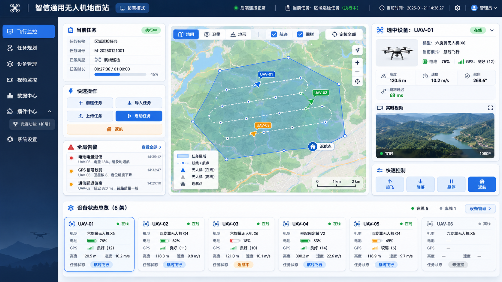

# 通用无人机地面站首页改版说明（供 Codex 执行）

> **项目：** ZHIXIN 通用无人机地面站\
> **改版对象：** 当前竞赛指挥台首页及其前端页面\
> **目标页面：** 飞行监控总览（首页）\
> **设计参考图：** `智信通用无人机地面站控制台.png`\
> **适用仓库：** `minstrelll1/ZHIXIN`\
> **建议开发分支：** `refactor/universal-uav-gcs-v1`\
> **文档用途：** 本文件用于指导 Codex
> 对现有地面站前端进行界面重构。请先阅读并检查现有代码，再按本说明实施。

------------------------------------------------------------------------

## 1. 本次改版的目标

本次不是在原有竞赛首页上简单替换标题、颜色和按钮，而是要把首页从"竞赛任务指挥台"调整为真正面向日常使用的**通用无人机飞行监控界面**。

改版后的首页名称：

**飞行监控**

软件名称建议统一为：

**智信通用无人机地面站**

首页的核心信息组织方式调整为：

**设备状态总览 + 实时地图 + 当前设备详情 + 当前任务与告警**

用户打开软件后，首先应该看到：

1.  后端和地面站当前运行状态。
2.  当前接入的无人机数量及在线状态。
3.  无人机在地图上的实时位置和航迹。
4.  当前选中无人机的关键遥测数据。
5.  当前任务及需要关注的告警。

首页不再以比赛科目、比赛计时、成果上报、比赛区域参数和竞赛程序状态为中心。

### 1.1 设计目标

-   具有成熟桌面软件的视觉风格，而不是普通表单页面。
-   信息层级清晰，地图是首页的视觉中心。
-   界面支持单机，也支持多机；设备卡片数量由实际设备列表动态决定。
-   竞赛功能保留为可选扩展入口，不占据首页主要空间。
-   沿用当前项目已经实现的地图、视频、遥测、WebSocket 和设备通信能力。
-   前端改版不应破坏现有后端接口和真机通信逻辑。
-   界面显示必须以实际数据为依据，不得把示例数据伪装成真实遥测。

------------------------------------------------------------------------

## 2. 设计参考图

请将配套图片 `智信通用无人机地面站控制台.png` 与本 Markdown
文件一起放在仓库根目录，供 Codex 对照实现。



**参考图是布局和视觉方向参考，不是要求照搬其中的示例数据。**

参考图中出现的 UAV-01～UAV-06、无人机型号、电池电量、GPS
状态、高度、速度、任务名称、地图区域、航迹和视频画面，均为设计示意数据。实际程序必须读取后端数据。没有真实数据时，应显示"暂无数据""未连接"或模拟模式明确标识，不得直接显示图中的数值。

### 2.1 参考图的总体布局

界面由五个主要区域组成：

1.  顶部全局状态栏。
2.  左侧垂直导航栏。
3.  中间主工作区的三栏布局：
    -   左栏：当前任务、快速操作、全局告警。
    -   中栏：地图主视图。
    -   右栏：选中设备详情、实时视频、快速控制。
4.  底部设备状态总览。
5.  竞赛功能作为插件中心的子入口，不进入首页主操作区。

------------------------------------------------------------------------

## 3. 页面整体结构

### 3.1 页面区域示意

``` text
┌──────────────────────────────────────────────────────────────────────────────┐
│ 顶部栏：软件名称 | 仿真/只读/真机模式 | 后端状态 | 当前任务 | 时间 | 设置 | 用户 │
├──────────────┬───────────────────────────────────────────────────────────────┤
│              │                                                               │
│  左侧导航栏   │  左侧任务与告警       中央地图主视图       右侧设备详情          │
│              │  ┌────────────┐    ┌────────────────┐   ┌──────────────┐      │
│  飞行监控     │  │ 当前任务    │    │                │   │ 选中设备      │      │
│  任务规划     │  ├────────────┤    │                │   │ 设备基本信息  │      │
│  设备管理     │  │ 快速操作    │    │   实时地图      │   │ 实时遥测      │      │
│  视频监控     │  ├────────────┤    │                │   │ 视频预览      │      │
│  数据中心     │  │ 全局告警    │    │                │   │ 快速控制      │      │
│  插件中心     │  └────────────┘    └────────────────┘   └──────────────┘      │
│  系统设置     │                                                               │
│              ├───────────────────────────────────────────────────────────────┤
│              │ 设备状态总览：根据实际设备数量动态排列设备卡片                  │
└──────────────┴───────────────────────────────────────────────────────────────┘
```

### 3.2 桌面端尺寸与比例

优先针对常见桌面显示器实现，设计参考基准为 16:9 桌面窗口。

建议尺寸：

-   顶部栏高度：约 56～64 px。
-   左侧导航栏宽度：约 180～200 px。
-   主工作区左右留白：约 16～20 px。
-   主工作区上半部分：左栏约 22%～25%，地图约 43%～47%，右栏约
    29%～32%。
-   底部设备总览占据主工作区全宽。
-   主工作区应尽量利用可视高度，避免页面出现大量无意义空白。

以上为布局参考值，应使用 CSS Grid/Flex
实现，不要把页面写成固定像素截图。窗口缩放时应保持合理比例。

### 3.3 页面滚动原则

-   顶部栏和左侧导航栏尽量固定。
-   地图区域应有稳定的可视高度。
-   左侧任务和告警卡片内部可以独立滚动。
-   设备数量较多时，底部设备总览允许横向滚动或自动换行。
-   不允许因为设备数量增加导致卡片相互覆盖。
-   不要让整页同时出现多个不必要的滚动条。

------------------------------------------------------------------------

## 4. 顶部全局状态栏

### 4.1 左侧品牌区域

显示：

-   软件图标。
-   软件名称：**智信通用无人机地面站**。
-   当前运行模式标签。

运行模式至少区分：

-   **仿真模式**
-   **只读模式**
-   **真机模式**

模式标签应根据后端实际运行配置显示，不允许前端自行推断。

### 4.2 右侧状态区域

从左到右建议显示：

1.  后端连接状态。
2.  当前任务摘要。
3.  当前系统时间。
4.  系统设置入口。
5.  当前用户或操作员入口。

状态文字建议：

-   后端连接正常
-   后端连接中
-   后端连接断开
-   当前无任务
-   当前任务：任务名称（执行中）

如果没有任务，显示"当前无任务"，不要显示空白或比赛科目占位符。

### 4.3 顶部区域需要删除的旧内容

从首页顶部移除：

-   竞赛程序地面端状态。
-   竞赛程序机载端状态。
-   车辆工事检测程序。
-   人员检测程序。
-   自主飞行指令程序。
-   抛投程序。
-   其他固定比赛程序状态。

这些内容如仍有使用价值，迁移到"插件中心"或独立的程序管理页面。

------------------------------------------------------------------------

## 5. 左侧垂直导航栏

导航栏采用深蓝色背景，图标和文字统一，当前选中页面使用蓝色高亮背景。

一级导航按以下顺序排列：

  顺序   名称       页面职责
  ------ ---------- --------------------------------------------
  1      飞行监控   首页，显示地图、设备状态、任务摘要和告警
  2      任务规划   航点、航线、区域、任务参数和任务预览
  3      设备管理   设备注册、机型、协议、连接参数和设备能力
  4      视频监控   多路视频源、实时画面和录像状态
  5      数据中心   飞行记录、遥测历史、任务记录、日志和回放
  6      插件中心   可选功能扩展，包括竞赛扩展
  7      系统设置   地图、通信、显示、权限、数据存储和系统配置

### 5.1 导航交互

-   点击一级导航切换到对应页面。
-   当前页面必须有明确的选中状态。
-   插件中心可展开子菜单。
-   竞赛扩展只作为插件中心下的一个子项，例如"竞赛功能（扩展）"。
-   不允许把比赛科目直接放在一级导航。
-   页面切换后，顶部全局状态栏保持一致。
-   若当前项目暂时没有独立前端路由，可先使用现有页面跳转方式实现，不强制引入新框架。

------------------------------------------------------------------------

## 6. 主工作区：三栏布局

主工作区上半部分由左、中、右三栏组成。

### 6.1 左栏：任务与告警

左栏从上到下包含三个卡片：

#### A. 当前任务

卡片标题：**当前任务**

显示字段：

  字段       显示内容
  ---------- ------------------------------------------
  任务名称   当前任务名称
  任务编号   任务唯一编号
  任务类型   航点飞行、区域巡检、自定义任务等
  任务状态   待执行、上传中、执行中、暂停、完成、失败
  任务时长   已运行时间；如有计划时长可同时显示
  执行进度   仅当后端能提供可信进度时显示

交互要求：

-   无任务时显示"暂无活动任务"。
-   有任务时显示任务名称和状态。
-   任务进度未知时不显示虚假的百分比。
-   不显示"当前科目""比赛时限""比赛已用时间"等竞赛字段。
-   点击卡片可进入任务详情或任务规划页面。

#### B. 快速操作

卡片标题：**快速操作**

建议按钮：

-   创建任务
-   导入任务
-   查看任务
-   打开任务规划

如果当前系统已经支持上传、启动、暂停等操作，可以根据任务状态和设备能力显示：

-   上传任务
-   启动任务
-   暂停任务
-   继续任务
-   取消任务

**重要：**
快速操作必须根据当前设备能力、连接状态、任务状态和用户权限动态启用。不能为了视觉效果而把所有按钮都做成可点击状态。

返航属于飞行控制操作，应放在选中设备的快速控制区或经过确认的安全操作区域，不建议在左栏把"返航"做成没有对象范围的普通按钮。

#### C. 全局告警

卡片标题：**全局告警**

展示系统当前需要操作员关注的告警，例如：

-   电池电量低。
-   GPS 信号较弱。
-   定位状态无效。
-   通信延迟过高。
-   遥测数据超时。
-   视频流中断。
-   任务执行异常。
-   设备离线。

每条告警显示：

-   严重级别：提示、警告、严重。
-   设备名称（如与设备相关）。
-   告警标题。
-   简短说明。
-   发生时间。
-   是否已确认。

颜色约定：

-   绿色：正常状态，不作为告警主色。
-   黄色/橙色：一般警告。
-   红色：严重告警。
-   灰色：已恢复或已确认的历史状态。

告警数据必须来自后端诊断或设备状态，不得根据示例数字生成真实告警。

------------------------------------------------------------------------

## 7. 中栏：地图主视图

地图是首页最重要的视觉区域，应占据三栏中最大的宽度。

### 7.1 地图基础显示

地图至少支持显示：

-   已连接设备的当前位置。
-   离线设备的最后已知位置（必须明确标记为历史位置，不得伪装为实时位置）。
-   设备名称和编号。
-   设备朝向。
-   实时航迹。
-   历史航迹（可选显示）。
-   当前任务航线。
-   航点。
-   任务区域。
-   起飞点。
-   返航点。
-   地理围栏或禁入区域（如果系统已经支持）。

地图上应区分不同设备，颜色可采用蓝、绿、橙等有限颜色，但同一设备在地图标记、航迹和设备卡片中的识别颜色应保持一致。

### 7.2 地图工具栏

地图顶部放置紧凑工具栏：

-   地图
-   卫星
-   地形
-   航迹开关
-   围栏开关
-   定位全部设备

如果当前底图服务不支持某种图层，必须禁用该选项或明确提示，不得展示一个无法使用的切换按钮。

地图右侧可保留：

-   放大。
-   缩小。
-   定位到当前设备。
-   恢复默认视图。

### 7.3 地图图例

地图左下角显示简洁图例：

-   任务区域。
-   航线/航点。
-   在线无人机。
-   离线或历史位置。
-   返航点。

图例不能遮挡主要航迹和设备标记。

### 7.4 地图交互

-   点击设备标记，选中对应设备。
-   选中设备后，右侧详情区和底部对应设备卡片同步高亮。
-   点击"定位全部"后，地图自动调整视野以容纳当前有效位置。
-   点击航点或航线，可显示其详情；编辑功能放在任务规划页面。
-   地图数据为空时显示明确空状态，例如"等待设备位置数据"，不能显示虚构地图航迹。
-   无 GPS/定位数据的设备不应被放置在地图原点。

### 7.5 坐标和数据约束

-   地图展示层使用明确的地理坐标。
-   后端负责协议数据转换和坐标规范化。
-   前端不得自行猜测 WGS84、ENU、NED 或高度参考。
-   高度参考不明确时，详情中应显示"未知"或隐藏对应值。
-   位置时间戳过期时，地图标记应变灰或标注"最后位置"，并显示数据时间。

------------------------------------------------------------------------

## 8. 右栏：选中设备详情

右栏始终展示当前选中的一架设备。默认选中规则由前端明确实现，例如优先选择第一架在线设备；如果没有在线设备，则显示空状态。

### 8.1 设备信息卡

标题格式：

**选中设备：UAV-01**

显示：

-   设备名称。
-   在线/离线状态。
-   设备型号。
-   设备类型。
-   当前飞行模式。
-   解锁状态（如果协议提供）。
-   电池状态。
-   GPS/定位状态。

设备型号、类型和协议均来自设备配置或后端设备信息，不允许写死为 P600 或
SU17。

### 8.2 关键遥测卡片

建议使用小型指标卡显示：

  指标       示例显示
  ---------- ------------
  高度       120.5 m
  速度       10.2 m/s
  航向       268.6°
  电池       76%
  GPS        良好（12）
  链路延迟   68 ms

以上数值仅用于说明展示格式。实际界面必须绑定实时数据。

显示规则：

-   没有数据时显示"---"或"暂无数据"。
-   不支持的指标不显示或显示"不支持"。
-   数据过期时显示"数据已过期"。
-   电池、GPS 等状态的颜色应依据统一阈值配置，不要在前端各处写不同阈值。
-   航向角显示范围和单位应统一。
-   速度和高度必须明确单位。

### 8.3 实时视频

在右栏设备信息下方放置"实时视频"卡片：

-   显示当前选中设备绑定的视频源。
-   视频连接正常时显示实时画面。
-   视频断流时显示"视频连接中断"及重连状态。
-   没有视频源时显示"未配置视频源"。
-   提供全屏入口。
-   如果已有截图、录像功能，可显示对应操作入口。
-   视频窗口尺寸应稳定，不能因视频加载失败而使右栏布局跳动。

视频流仍沿用现有 MediaMTX/RTSP/WebRTC 实现，前端改版不得破坏当前视频
URL、端口和鉴权逻辑。

### 8.4 快速控制

右栏底部放置"快速控制"区域。

可根据设备能力显示：

-   起飞
-   降落
-   悬停
-   返航

控制要求：

1.  控制按钮必须依据设备能力动态显示或禁用。
2.  设备离线、遥测过期、状态未知时，禁止执行危险控制。
3.  真机模式下，起飞、降落、返航等关键操作必须经过权限校验和明确确认。
4.  仿真模式下只能调用仿真适配器，不得发送真实设备指令。
5.  按钮点击后显示"请求中"，等待后端回执后更新状态。
6.  超时、拒绝和失败必须明确提示。
7.  不得仅凭前端点击就把设备状态改成"已起飞"或"已返航"。
8.  快速控制不是安全保护的替代品，机载端必须具备独立失联保护。

------------------------------------------------------------------------

## 9. 底部：设备状态总览

标题：

**设备状态总览**

标题右侧显示：

-   在线数量。
-   离线数量。
-   设备管理入口。

例如：

`在线 5    离线 1    设备管理 >`

数量必须由设备管理服务实时统计，不能固定显示 6 架。

### 9.1 设备卡片内容

每张设备卡片建议显示：

1.  设备名称。
2.  在线/离线状态。
3.  设备型号或类型。
4.  电池状态。
5.  GPS/定位状态。
6.  高度。
7.  速度。
8.  当前任务或飞行状态。

建议卡片结构：

``` text
┌─────────────────────────────────────┐
│ UAV-01                       ● 在线 │
│ 机型：六旋翼无人机                    │
│ 电池：76%       GPS：良好             │
│ 高度：120.5 m   速度：10.2 m/s       │
│ 状态：航线飞行                       │
└─────────────────────────────────────┘
```

### 9.2 动态布局

-   不得在 HTML 中写死六张设备卡片。
-   根据设备列表循环生成卡片。
-   1 架设备时显示 1 张卡片，不应保留 5 个空卡片。
-   2～4 架时自适应排列。
-   设备较多时支持横向滚动或换行。
-   设备卡片点击后选中设备，并联动地图和右侧详情。
-   当前选中卡片使用蓝色边框或浅蓝背景。
-   离线卡片降低视觉强调，但仍保留设备信息。
-   不得将离线设备最后一次遥测显示为当前实时数据。

------------------------------------------------------------------------

## 10. 竞赛功能的处理方式

本次首页改版必须弱化比赛功能，但**不要求删除竞赛业务**。

### 10.1 首页移除的竞赛元素

以下元素从首页主区域移除：

-   比赛科目选择。
-   比赛时限。
-   比赛已用时间。
-   科目一/科目二成果上报。
-   识别类别选择。
-   比赛区域与规划参数。
-   比赛阶段和比赛剩余时间。
-   固定六机模拟按钮。
-   竞赛程序地面端/机载端状态列表。
-   车辆工事检测、人员检测、抛投等比赛专用程序入口。

### 10.2 竞赛功能迁移位置

统一放在：

**插件中心 → 竞赛功能（扩展）**

竞赛插件页面可以保留原有：

-   比赛科目。
-   比赛计时。
-   比赛区域和专项规划参数。
-   成果上报。
-   识别类别配置。
-   比赛程序状态。
-   比赛专用任务执行流程。

竞赛插件应调用通用核心的设备、遥测、地图、视频和任务能力，不应让通用首页依赖竞赛模块。

### 10.3 旧功能迁移表

  原首页元素           新位置
  -------------------- --------------------------------------------
  比赛科目             竞赛插件
  比赛时限             竞赛插件
  比赛计时器           竞赛插件
  规划并分派           通用任务规划或竞赛插件专用任务流程
  科目一成果上报       竞赛插件
  一键起飞预检         通用安全检查流程；保留原有竞赛专用检查差异
  识别类别             竞赛插件
  比赛区域与规划参数   竞赛插件
  竞赛程序状态         插件中心/程序管理
  模拟六机按钮         仿真与调试工具，不作为默认首页操作

------------------------------------------------------------------------

## 11. 视觉设计规范

### 11.1 整体风格

采用：

**深蓝导航 + 浅灰工作区 + 白色卡片 + 蓝色主操作 + 克制的状态色**

避免：

-   过亮的渐变背景。
-   大面积高饱和颜色。
-   过多不同形状的卡片。
-   每个模块都使用不同风格的按钮。
-   大面积装饰性阴影。
-   不必要的动画和闪烁。
-   为了显得"科技感"而加入大量装饰线条。

### 11.2 建议颜色

``` css
:root {
  --gcs-navy: #102B4C;
  --gcs-navy-deep: #0B203A;
  --gcs-blue: #2468D8;
  --gcs-blue-soft: #EAF2FF;

  --gcs-page-bg: #F3F6FA;
  --gcs-card-bg: #FFFFFF;
  --gcs-border: #DCE4EE;

  --gcs-text: #17263C;
  --gcs-text-secondary: #68788E;
  --gcs-text-muted: #94A1B2;

  --gcs-success: #1E9B67;
  --gcs-warning: #E6A23C;
  --gcs-danger: #D84A4A;
  --gcs-offline: #8995A5;
}
```

### 11.3 字体与字号

优先使用系统字体栈，兼容 Windows 中文环境：

``` css
font-family:
  "Microsoft YaHei UI",
  "Microsoft YaHei",
  "PingFang SC",
  system-ui,
  sans-serif;
```

建议：

  内容                  字号
  -------------- -----------
  软件名称         18～21 px
  页面标题         20～24 px
  卡片标题         15～17 px
  正文             13～14 px
  辅助说明         11～12 px
  关键遥测数字     18～24 px

### 11.4 卡片和按钮

-   卡片圆角建议 10～14 px。
-   卡片边框使用浅灰色。
-   阴影轻微，不要厚重。
-   卡片内边距统一。
-   主按钮使用蓝色实心样式。
-   次按钮使用浅蓝或描边样式。
-   危险操作使用红色，但不要将普通"返航"入口做成无确认的一键危险操作。
-   同一视觉区域最多设置一个主要强调按钮。
-   图标统一使用同一套图标库，避免混用风格差异明显的图标。

------------------------------------------------------------------------

## 12. 页面状态与异常状态

Codex 必须同时实现正常状态和异常状态，不能只做一张静态展示页。

### 12.1 后端连接状态

-   正常：绿色状态点 + "后端连接正常"。
-   连接中：黄色状态点 + "正在连接"。
-   断开：红色状态点 + "后端连接断开"。
-   重连：显示"正在重新连接"。

### 12.2 设备状态

-   在线且遥测新鲜：显示在线。
-   在线但遥测超时：显示"遥测超时"，不可当作正常设备。
-   离线：显示离线。
-   未配置连接：显示"连接未配置"。
-   设备状态未知：显示"状态未知"。

### 12.3 地图状态

-   有有效位置：显示设备标记。
-   无有效位置：不绘制在地图原点。
-   定位失效：显示定位异常状态。
-   位置过期：显示最后已知位置，并与实时位置区分。
-   无地图资源：显示地图加载失败提示。

### 12.4 视频状态

-   正常播放。
-   正在连接。
-   连接失败。
-   视频源未配置。
-   视频权限不足。

### 12.5 空任务状态

无任务时，左栏显示：

-   暂无活动任务。
-   创建任务。
-   导入任务。

不要显示"尚未规划比赛科目"或其他竞赛术语。

------------------------------------------------------------------------

## 13. 前端实施时必须保护的现有功能

本次是 UI 和前端结构改版，不是重新开发整个飞行控制后端。

Codex 在修改前必须先检查现有
`web/index.html`、`web/fleet.html`、`ground_entry.py` 和
`api.py`，记录：

-   当前页面使用的所有 API 路径。
-   当前 WebSocket 路径和消息结构。
-   页面依赖的 DOM ID。
-   视频 URL、端口和鉴权方式。
-   地图资源和地图初始化方式。
-   设备列表、遥测、任务状态和告警的数据来源。
-   当前按钮绑定的后端操作。

必须遵守：

1.  不得因为重新排版而删除已有 API。
2.  不得随意更改 WebSocket 消息格式。
3.  不得随意更改设备 ID、Topic、TCP 协议或视频端口。
4.  不得将前端示例数据写入生产状态。
5.  不得删除现有竞赛功能；先迁移入口并保留兼容访问。
6.  不得把原有功能按钮保留为没有实际处理逻辑的装饰按钮。
7.  不得让 UI 显示"成功"而后端实际指令尚未确认。
8.  地图、视频、遥测应分别处理加载失败，某个模块失败不应导致整个首页崩溃。

------------------------------------------------------------------------

## 14. 建议的前端代码拆分方式

如果当前项目仍以单个 `web/index.html`
为主，不要一次性全部拆分。建议分步实施：

### 第一步：保留现有入口，整理样式

-   保留当前首页 URL。
-   新建通用首页 CSS。
-   新建通用首页 JavaScript 模块。
-   将旧页面中的 API 调用和数据处理逻辑先整理出来。
-   优先完成导航栏、顶部栏、三栏布局和底部设备列表。

### 第二步：拆分公共组件

建议逐步拆分：

-   顶部状态栏。
-   左侧导航栏。
-   当前任务卡片。
-   快速操作卡片。
-   告警列表。
-   地图工具栏。
-   设备详情卡片。
-   遥测指标卡片。
-   视频窗口。
-   快速控制区。
-   设备状态卡片。

### 第三步：拆分页面

逐步形成：

-   飞行监控。
-   任务规划。
-   设备管理。
-   视频监控。
-   数据中心。
-   插件中心。
-   系统设置。

### 第四步：迁移竞赛页面

将竞赛科目、成果上报和比赛程序状态迁移到竞赛插件入口，并进行回归测试。

------------------------------------------------------------------------

## 15. 响应式和窗口适配要求

优先保证桌面端，兼顾较小分辨率。

-   1920×1080：完整显示三栏和底部设备总览。
-   1680×945 或相近尺寸：保持布局比例，允许适度压缩卡片。
-   1366×768：必要时将三栏调整为两栏，设备详情可以折叠或放到下方。
-   更窄窗口：左侧导航可折叠，设备卡片换行，地图保持可用。

不得通过固定宽高导致内容被裁剪。地图容器尺寸变化后，必须调用当前地图引擎对应的
resize/invalidate 方法，防止地图空白或错位。

------------------------------------------------------------------------

## 16. 前端验收清单

### 16.1 视觉验收

-   [ ] 首页标题为"智信通用无人机地面站"。
-   [ ] 页面主导航为通用地面站功能。
-   [ ] 深蓝导航栏、浅灰背景、白色卡片风格统一。
-   [ ] 地图为首页主要视觉区域。
-   [ ] 左栏只包含当前任务、快速操作和全局告警。
-   [ ] 右栏只展示当前选中设备的详情、视频和快速控制。
-   [ ] 底部设备总览紧凑、清晰。
-   [ ] 卡片、按钮、字体、间距和图标风格统一。
-   [ ] 没有竞赛计时器和科目选择占据首页主区域。
-   [ ] 没有固定六机布局限制。

### 16.2 功能验收

-   [ ] 无设备时页面正常显示空状态。
-   [ ] 单设备时正常显示。
-   [ ] 多设备时动态生成设备卡片。
-   [ ] 点击设备卡片，地图和右侧详情同步切换。
-   [ ] 地图位置来自实际遥测。
-   [ ] 过期位置有明确标记。
-   [ ] 后端断开时显示连接异常。
-   [ ] 视频未配置时显示空状态。
-   [ ] 视频断流时显示错误状态。
-   [ ] 任务不存在时显示"暂无活动任务"。
-   [ ] 任务存在时显示实际任务信息。
-   [ ] 所有按钮均有真实行为或明确禁用状态。
-   [ ] 真机危险操作具有确认、权限和后端回执流程。

### 16.3 兼容性验收

-   [ ] 原有 SU17/P600 设备接入不受影响。
-   [ ] 原有 TCP/ROS 通信不受影响。
-   [ ] 原有地图功能不受影响。
-   [ ] 原有视频功能不受影响。
-   [ ] 原有竞赛功能仍可从扩展入口进入。
-   [ ] 原有部署脚本仍可启动系统。
-   [ ] 现有相关测试通过，未通过项有明确记录。

------------------------------------------------------------------------

## 17. Codex 实施顺序

**本次只实施首页 UI 改版，不要顺带重构后端协议和任务系统。**

请按以下顺序执行：

### UI 阶段 0：现状审计

1.  检查当前分支和工作区。
2.  读取 `web/index.html`、`web/fleet.html`。
3.  梳理页面 DOM、CSS、JS、API、WebSocket 和视频依赖。
4.  将当前首页元素逐项映射到本说明的目标区域。
5.  输出 `docs/ui_redesign_audit.md`。
6.  不修改业务代码，先汇报审计结果。

### UI 阶段 1：新版首页布局

1.  新建或整理通用首页样式。
2.  实现顶部状态栏。
3.  实现左侧导航栏。
4.  实现左、中、右三栏布局。
5.  实现底部动态设备状态总览。
6.  先使用明确标记的模拟数据完成布局验证，但模拟数据必须与真实数据适配层隔离。
7.  完成后截图，与参考图比较。

### UI 阶段 2：接入真实数据

1.  将当前任务卡片接入真实任务数据。
2.  将设备状态总览接入设备列表。
3.  将右侧详情接入选中设备遥测。
4.  将告警列表接入真实诊断/告警数据。
5.  将地图接入现有位置和航迹数据。
6.  将视频区域接入现有视频流。
7.  所有空值、过期和错误状态均按本说明处理。

### UI 阶段 3：迁移竞赛入口

1.  移除首页竞赛科目、计时和成果上报区域。
2.  在插件中心增加竞赛扩展入口。
3.  将旧竞赛界面迁移到独立页面或独立路由。
4.  保留原有竞赛 API 和业务逻辑。
5.  完成竞赛功能回归测试。

### UI 阶段 4：最终检查

1.  检查桌面端不同分辨率。
2.  检查地图尺寸变化。
3.  检查视频断流。
4.  检查 WebSocket 断开和恢复。
5.  检查设备动态增减。
6.  检查所有按钮的实际行为。
7.  运行相关前端和后端测试。
8.  输出阶段报告和最终截图。

**每个阶段完成后暂停并汇报，不要未经确认连续执行所有阶段。**

------------------------------------------------------------------------

## 18. Codex 最终汇报格式

每阶段按以下格式汇报：

``` text
# 通用地面站 UI 改版报告

## 1. 本阶段完成内容
## 2. 修改和新增文件
## 3. 页面布局变化
## 4. 真实数据接入情况
## 5. 保留的原有功能
## 6. 已移除首页的竞赛元素
## 7. 测试命令及真实测试结果
## 8. 不同分辨率下的显示情况
## 9. 未完成事项和已知问题
## 10. 下一阶段建议
```

必须附上实际运行截图。不能只报告"已完成"，必须说明实际完成了哪些内容。

------------------------------------------------------------------------

## 19. 最终页面应达到的效果

改版完成后，首页应该具备以下产品特征：

-   第一眼看到的是无人机、地图和飞行状态，而不是比赛科目。
-   地图占据主要视觉区域，能直观反映设备位置、航迹和任务区域。
-   左侧任务与告警简洁明确。
-   右侧可以快速了解当前选中设备的状态。
-   底部设备总览能适应不同数量的设备。
-   竞赛功能保留，但作为可选插件存在。
-   页面没有固定六机、固定机型和固定比赛流程的假设。
-   所有数据来自真实后端或明确标注的仿真数据。
-   界面简洁、专业、稳定，适合作为通用无人机地面站软件的正式操作界面。

**最终原则：这是一款通用无人机地面站，不是把竞赛指挥台换一个名字。首页要围绕"设备、地图、遥测、任务和安全状态"组织，竞赛功能只作为扩展能力存在。**
